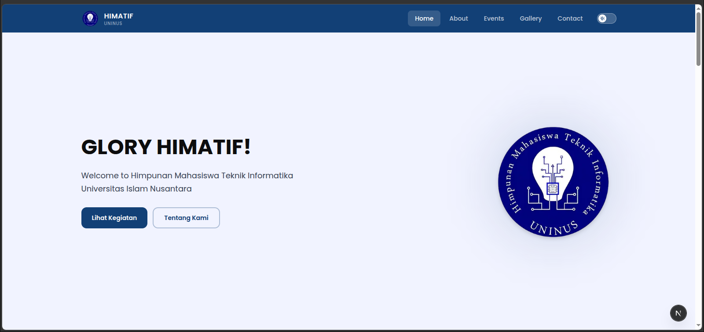
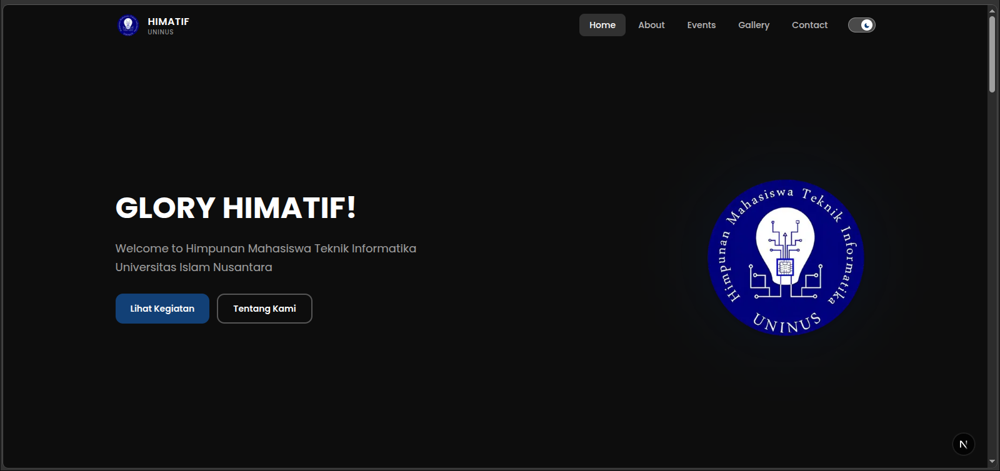

# HIMATIF UNINUS Website


The official website project for **HIMATIF UNINUS**, the Informatics Engineering
Student Association at Universitas Islam Nusantara. It combines a responsive
public-facing website with an admin dashboard for managing event and gallery
content.

## Screenshots

| Homepage — Light Theme                                           | Homepage — Dark Theme                                          |
| ---------------------------------------------------------------- | -------------------------------------------------------------- |
|  |  |

## Features

### Public website

- Responsive homepage with association information, work programs, activities,
  event highlights, and FAQs.
- About, events, gallery, and contact pages.
- Search and status filters on the event listing.
- Event detail pages and gallery category filters.
- Light and dark themes.
- Accessible, keyboard-friendly dialogs and reduced-motion-aware animations.

### Admin dashboard

- Admin sign-in backed by the API.
- Dashboard overview with event and gallery summaries.
- Create, edit, and delete event and gallery records.
- Image uploads with JPG, PNG, and WEBP support and a 5 MiB size limit.
- Form validation, upload previews, loading states, and themed success/error
  notifications.

Homepage event highlights include local demo content so the landing page has
event cards even when no live event records are available from the backend.
The events and gallery pages otherwise load their content from the API.
Clearly identify demo content in a public deployment if it could be mistaken
for actual association records.

## Technology Stack

| Area             | Technologies                                     |
| ---------------- | ------------------------------------------------ |
| Frontend         | Next.js 16, React 19, TypeScript, Tailwind CSS 4 |
| UI and forms     | Framer Motion, React Hook Form, Zod              |
| Backend          | Go, Gin, GORM                                    |
| Database         | PostgreSQL 16                                    |
| Authentication   | JWT bearer tokens                                |
| Frontend testing | Vitest, Playwright browser provider, Storybook   |
| Backend testing  | Go `testing` package                             |

## Repository Structure

```text
.
├── backend/
│   ├── cmd/                 # API server and initial-admin seed command
│   ├── config/              # Database configuration
│   ├── docs/api/            # API guide, OpenAPI spec, and Swagger UI
│   ├── helper/              # Shared helpers, including image upload
│   ├── internal/
│   │   ├── domain/          # Data entities
│   │   ├── handler/         # HTTP handlers
│   │   ├── middleware/      # Authentication, role, and CORS middleware
│   │   ├── repository/      # Persistence layer
│   │   └── service/         # Application logic
│   ├── router/              # API route registration
│   ├── test/                # Per-feature API integration tests
│   ├── .env.example         # Backend environment template
│   └── docker-compose.yml   # Local PostgreSQL service
├── frontend/
│   ├── public/              # Static assets
│   ├── src/
│   │   ├── app/             # Public, admin, and Next.js API routes
│   │   ├── components/      # Page sections and shared UI
│   │   ├── constants/       # Navigation and local demo content
│   │   ├── hooks/           # Data and UI hooks
│   │   ├── lib/             # API client and utilities
│   │   ├── schemas/          # Form schemas
│   │   └── types/            # Shared TypeScript types
│   ├── .env.example         # Frontend environment template
│   └── README.md            # Frontend-specific guide
├── images/                  # Project cover and homepage screenshots
└── README.md                # Project overview and setup guide
```

## Requirements

- Node.js and npm.
- Go version compatible with the version declared in `backend/go.mod`.
- Docker with Docker Compose for the local PostgreSQL database.

## Local Development

The frontend and backend run as separate applications. Keep a terminal open
for each service.

### 1. Configure and start the backend

```bash
cd backend
cp .env.example .env
```

Edit `backend/.env` and set at least:

- `DB_USER` and `DB_PASSWORD` for the local PostgreSQL container.
- A strong, private `JWT_SECRET`.
- `ADMIN_NAME`, `ADMIN_EMAIL`, and `ADMIN_PASSWORD` for the initial admin
  account.
- `ALLOWED_ORIGIN=http://localhost:3001` for the frontend development server.

Start PostgreSQL:

```bash
docker compose up -d
```

Create the initial admin account after PostgreSQL is available:

```bash
go run ./cmd/admin-seed
```

Start the API:

```bash
go run ./cmd/api
```

The backend listens on `http://localhost:3000` by default. It applies GORM
auto-migrations at startup and serves uploaded images from `/uploads/`.

### 2. Configure and start the frontend

In a separate terminal:

```bash
cd frontend
npm ci
cp .env.example .env
```

Set the backend base URL in `frontend/.env`:

```dotenv
NEXT_PUBLIC_API_URL=http://localhost:3000
```

Start the Next.js development server:

```bash
npm run dev
```

Open [http://localhost:3001](http://localhost:3001).

More detailed setup, routes, environment variables, and deployment notes are
available in the [frontend README](frontend/README.md) and
[backend API documentation](backend/docs/api/README.md).

## Environment Configuration

### Frontend

| Variable              | Purpose                                                                                                     |
| --------------------- | ----------------------------------------------------------------------------------------------------------- |
| `NEXT_PUBLIC_API_URL` | Backend base URL, such as `http://localhost:3000`. Required for live API-backed pages and admin operations. |

This variable is public by design. Do not put passwords, private tokens, or
other secrets in frontend environment variables with the `NEXT_PUBLIC_` prefix.

### Backend

The backend configuration template is in [backend/.env.example](backend/.env.example).
It includes PostgreSQL connection settings, the JWT signing secret, initial
admin account values, allowed CORS origin, and upload directory.

`JWT_EXPIRED_HOUR` and `MAX_FILE_SIZE` are currently listed in the template but
are not read by the implementation: token lifetime is fixed at 24 hours and
the upload limit is fixed at 5 MiB.

## Useful Commands

### Frontend

Run commands from `frontend/`:

| Command                   | Purpose                                    |
| ------------------------- | ------------------------------------------ |
| `npm run dev`             | Start the development server on port 3001. |
| `npm run lint`            | Run ESLint.                                |
| `npm test`                | Run the unit test project.                 |
| `npm run build`           | Build the production application.          |
| `npm run start`           | Serve the production build on port 3001.   |
| `npm run storybook`       | Start Storybook on port 6006.              |
| `npm run build-storybook` | Build the static Storybook site.           |

### Backend

Run commands from `backend/`:

| Command                   | Purpose                                                   |
| ------------------------- | --------------------------------------------------------- |
| `go run ./cmd/api`        | Start the API server.                                     |
| `go run ./cmd/admin-seed` | Create the first admin account from environment settings. |
| `go test ./...`           | Run all backend tests.                                    |
| `go vet ./...`            | Run Go static analysis.                                   |
| `docker compose up -d`    | Start the local PostgreSQL container.                     |
| `docker compose down`     | Stop the local PostgreSQL container.                      |

## API and Authentication

- The backend API base URL is `http://localhost:3000` in local development.
- Public event and gallery endpoints are under `/api/v1/events` and
  `/api/v1/galleries`.
- Admin endpoints are protected by a JWT and the `admin` role.
- The frontend sends admin sign-in through its Next.js server route. The JWT is
  stored in an `HttpOnly` cookie rather than browser storage.
- Admin CRUD and upload requests pass through the Next.js API proxy to the Go
  backend.
- The initial admin is created using the backend seed command. Public admin
  registration is disabled; authenticated administrators can create further
  admin accounts.
- Interactive API documentation is served at
  [http://localhost:3000/docs/swagger.html](http://localhost:3000/docs/swagger.html)
  when the backend is running.

See the [API README](backend/docs/api/README.md) and
[OpenAPI specification](backend/docs/api/openapi.yaml) for endpoint details,
request schemas, and responses.

## Testing

Run the frontend checks:

```bash
cd frontend
npm test
npm run lint
npm run build
```

Run the backend checks:

```bash
cd backend
go test ./...
go vet ./...
```

Backend API integration tests cover auth, event and gallery flows, and image
upload through the router, middleware, handlers, and services. They use
in-memory repositories and temporary upload directories; they do not test
PostgreSQL queries or migrations. Use a separate test database for any manual
database integration checks—never run tests against production data.

## Deployment Notes

- Set `NEXT_PUBLIC_API_URL` to the public backend base URL before building the
  frontend.
- Configure backend CORS to allow the deployed frontend origin.
- Use HTTPS in production and a strong secret for `JWT_SECRET`.
- Ensure the backend's upload directory is persistent and publicly served
  under `/uploads/`.
- The Next.js image optimizer allows uploaded images only from the host
  configured by `NEXT_PUBLIC_API_URL`.
- No production API hostname is configured in this repository. Set the actual
  deployment URL in the hosting environment and OpenAPI server configuration
  before publishing it as a live service.

## Contributing

1. Create a branch for your change.
2. Keep frontend UI, schemas, shared types, and API logic in their existing
   project areas.
3. Add or update relevant tests.
4. Run the frontend lint/build/tests or backend tests/vet for the areas changed.
5. Do not commit `.env` files, credentials, or production data.

## License

This project is licensed under the MIT License. See [LICENSE](LICENSE) for the
full license text.
